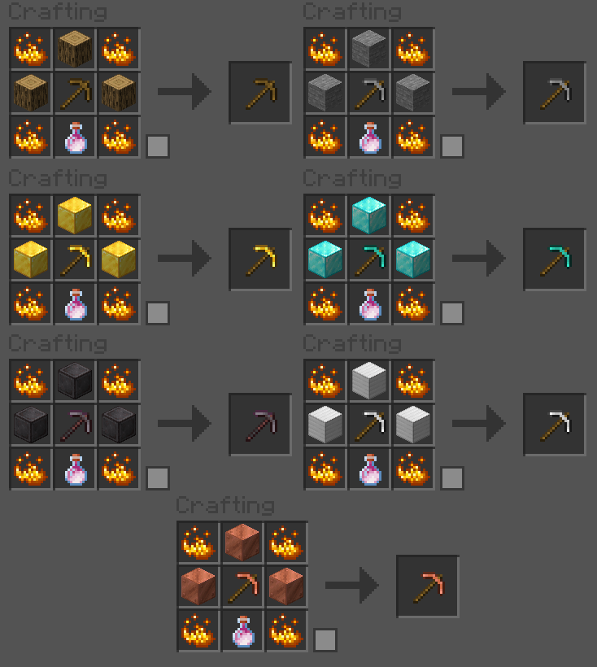

# Jodelle Power Mining

Spigot 1.26+ | License: LGPL v3

A modernized PowerTools plugin for Spigot and Paper servers updated for Minecraft 26.3. Adds configurable Hammers, Excavators, and Plows for area mining, digging, and farming.

## Overview

Jodelle Power Mining is a updated version of the original PowerMining plugin written by bloodyshade back in 2013.

The code was recently refactored to clean up the listeners, fix concurrency bugs, support modern Paper/Spigot APIs, and add native support for new 26.3 features like copper tools.

Features:
* Hammers, Excavators, and Plows with 3x3 area mining/digging/tilling
* Adjustable recipes via JSON
* Configurable radius and depth
* Permission nodes for crafting, using, and enchanting
* WorldGuard protection support (optional)
* Enchantments carry over from ingredients when crafting tools
* JSON configs instead of standard YAML
* Updated for Minecraft 26.3

## Installation

1. Grab the jar from the Releases page.
2. Put it into your server's plugins folder.
3. Restart the server.
4. Config files auto generate inside /plugins/JodellePowerMining/

## Configuration

Files are created inside `/plugins/JodellePowerMining/`

* `config.json`: Main settings (radius, depth, durability handling)
* `recipes.json`: Defines custom crafting patterns
* `mineable.json`: Defines blocks mineable by hammers
* `diggable.json`: Defines blocks diggable by excavators

### Example config.json

```json
{
  "Radius": 1,
  "Deep": 0,
  "useDurabilityPerBlock": false
}
```

### Example recipes.json

```json
{
  "Recipes": {
    "COPPER_HAMMER": [
      "COPPER_BLOCK*1", "COPPER_BLOCK*1", "COPPER_BLOCK*1",
      "EMPTY", "STICK*1", "EMPTY",
      "EMPTY", "STICK*1", "EMPTY"
    ]
  }
}
```

Each entry represents a 3x3 grid from top left to bottom right. Use `EMPTY` for blank slots. Format is `MATERIAL*AMOUNT`.

### Example mineable.json

```json
{
  "Minable": {
    "STONE": ["any"],
    "IRON_ORE": ["IRON_HAMMER", "COPPER_HAMMER", "DIAMOND_HAMMER"]
  }
}
```

Setting `any` allows all hammer tiers to mine that block.

### Example diggable.json

```json
{
  "Diggable": [
    "DIRT",
    "GRASS_BLOCK",
    "SAND"
  ]
}
```

### Recipes layout

Visual recipe reference for crafting:



## Commands

* `/jpm version`: Shows active plugin version
* `/jpm give <toolname>`: Spawns a tool into inventory (e.g. `/jpm give DIAMOND_HAMMER`)

Note: Give command targets the player running the command.

## Permissions

* `powermining.use.<type>.<material>`: Permission to use tool (e.g. `powermining.use.hammer.copper`)
* `powermining.craft.<type>.<material>`: Permission to craft tool
* `powermining.enchant.<type>.<material>`: Permission to enchant tool
* `powermining.give`: Access to `/jpm give`

Examples:
* `powermining.craft.hammer.diamond`
* `powermining.use.excavator.netherite`
* `powermining.enchant.plow.copper`

## WorldGuard Integration

If WorldGuard is present, the plugin checks build/break flags before breaking surrounding blocks. If WorldGuard is not installed, it skips the check automatically.

## Notes & Changelog

2026 Updates:
* Updated listener implementations for Spigot/Paper 26.3
* Fixed thread safety issue in BlockBreakListener (removed stored instance variables)
* Switched to UUIDs for player tracking in listeners
* Added support for copper tool variants (Copper Hammer, Excavator, Plow)
* Replaced deprecated enchantment API calls with modern Registry lookups

Original license remains LGPL v3 under bloodyshade's original terms.
